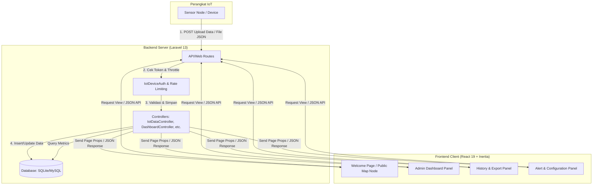
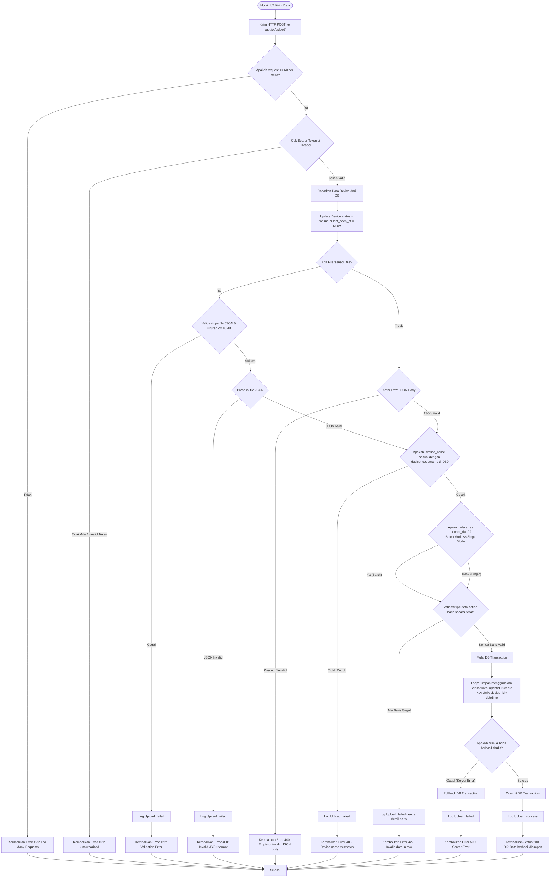
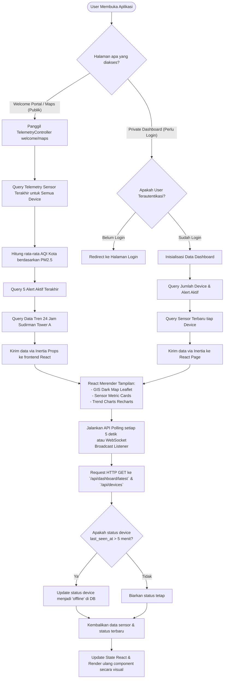
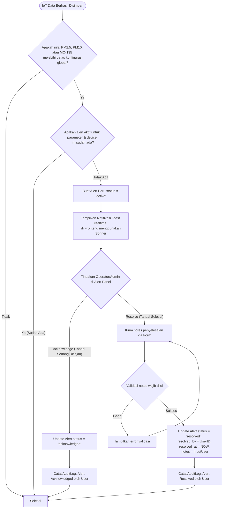
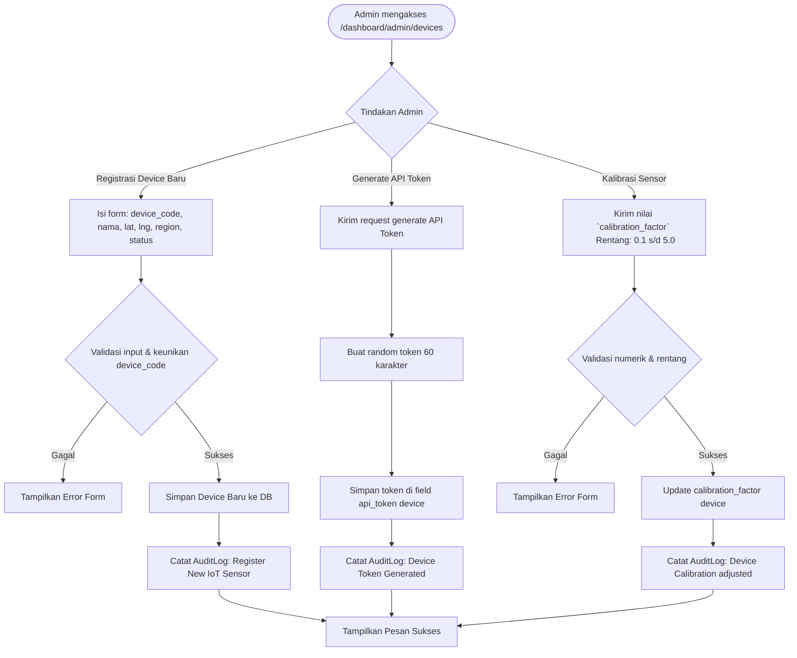
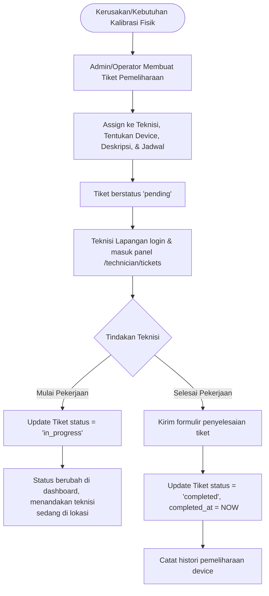

# 📊 Flowchart Alur Program - Smart City Air Monitoring Dashboard

Dokumen ini menjelaskan alur program, arsitektur, dan aliran data (*data flow*) pada aplikasi **Smart City Air Monitoring Dashboard**. Diagram dalam dokumen ini menggunakan format **Mermaid** yang dapat dirender secara visual pada editor Markdown modern.

---

## 🗺️ Gambaran Umum Sistem (System Architecture Overview)

Aplikasi ini menggunakan arsitektur hybrid **Laravel (Backend)** dan **React + TypeScript + Inertia.js (Frontend)**, yang berkomunikasi dengan perangkat **IoT (Sensors)** melalui API HTTP RESTful.

---

## 🔌 1. Alur Upload Data Sensor dari Perangkat IoT (Data Ingestion Flow)

Perangkat IoT mengirim data kualitas udara secara berkala (misal: setiap 5 menit) menggunakan token khusus perangkat (*Device Token*). Upload mendukung mode **File Upload (JSON)** atau **Raw JSON Body** dengan format **Batch** (direkomendasikan) atau **Single**.

---

## 📊 2. Alur Visualisasi Data Real-time & Dashboard (Client View Flow)

Visualisasi data pada dashboard frontend (menggunakan React + Leaflet Map) memiliki dua cara utama dalam memuat data: melalui **Inertia.js (Server-Side Rendered Props)** untuk halaman awal, atau **API Polling (JSON HTTP Client)** untuk pembaruan real-time.

---

## ⚠️ 3. Alur Deteksi Dini & Manajemen Peringatan (Alert System Flow)

Sistem peringatan berfungsi mendeteksi anomali/polusi berlebih, memberi tahu petugas monitoring, dan melacak langkah penyelesaian (*resolution*).

---

## 🔧 4. Alur Manajemen Perangkat & Kalibrasi (Device Management Flow)

Alur penambahan device baru, pembuatan API token autentikasi, serta kalibrasi sensor oleh Administrator.

---

## 🛠️ 5. Alur Tiket Pemeliharaan Teknisi (Maintenance Ticket Flow)

Digunakan untuk mendistribusikan penugasan perbaikan atau kalibrasi fisik sensor di lapangan kepada teknisi.

---

> [!NOTE]
> Seluruh aksi administrator (seperti konfigurasi, pengelolaan pengguna, backup database, update whitelisting IP, dan edit device) secara otomatis tercatat di tabel `audit_logs` demi alasan keamanan dan kepatuhan sistem (*compliance*).
