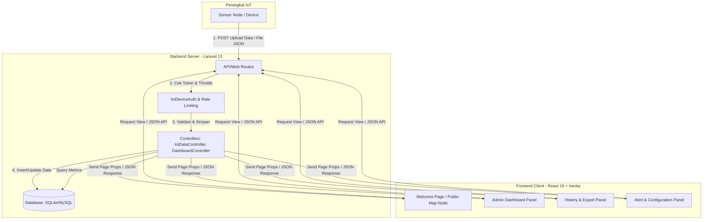
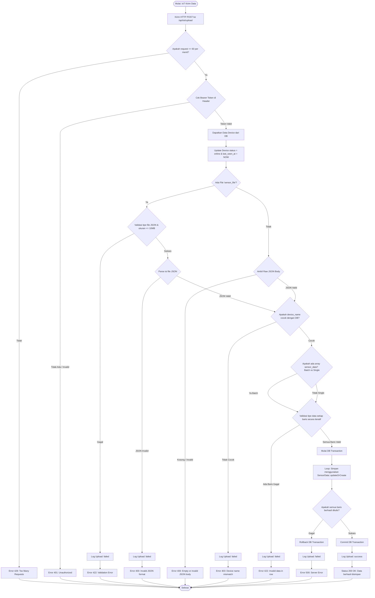
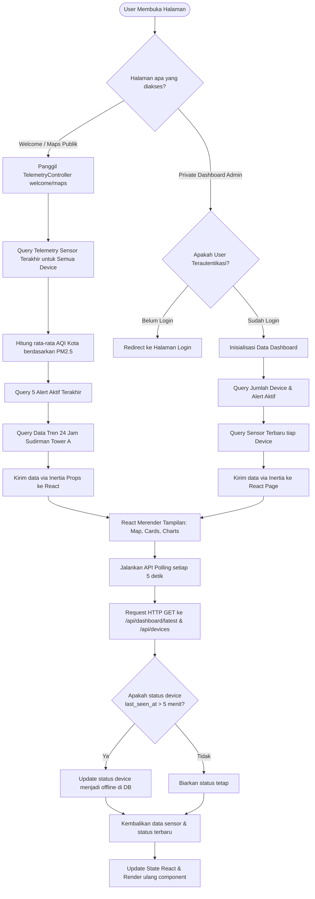
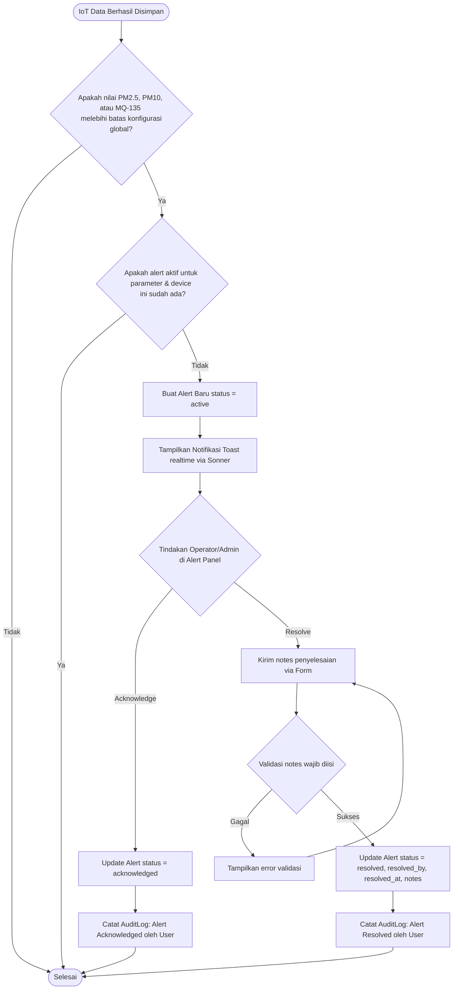
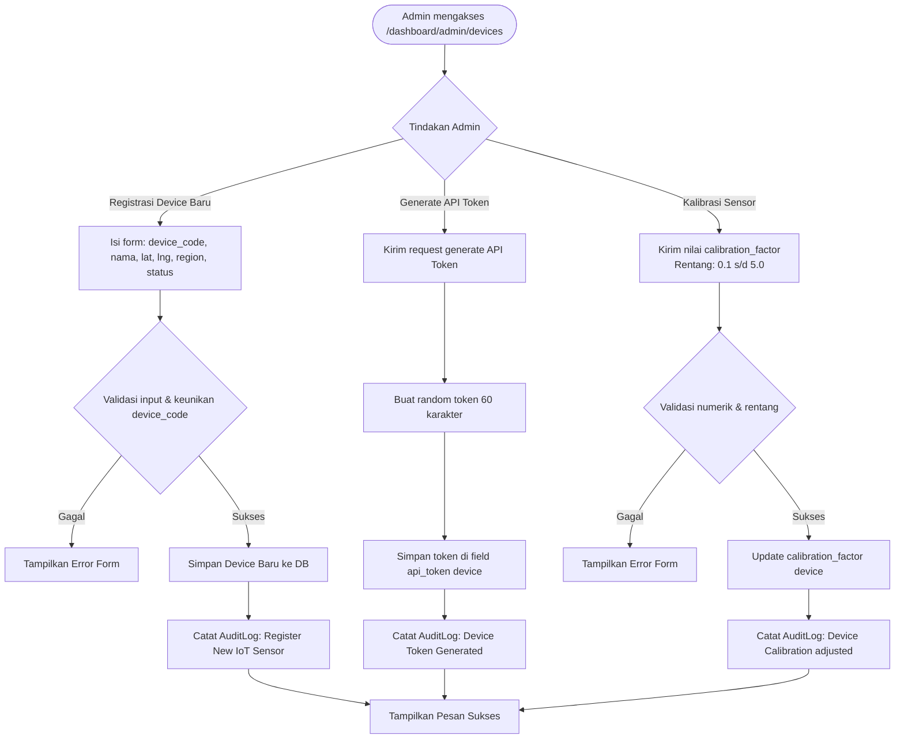
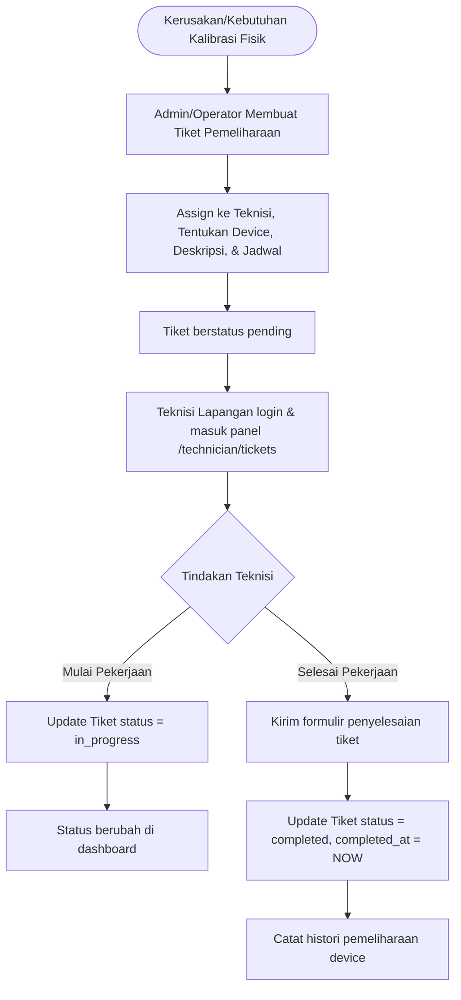

# 🎨 Panduan Ekspor & Impor Flowchart ke Draw.io

Draw.io mendukung impor diagram **Mermaid** secara langsung. Anda dapat menyalin kode Mermaid dari diagram di bawah ini dan memasukkannya ke dalam Draw.io untuk menghasilkan flowchart yang dapat diedit secara visual.

## 🚀 Cara Impor ke Draw.io (Langkah-langkah)

1. Buka [draw.io](https://app.diagrams.net/).
2. Buat diagram baru atau buka diagram yang sudah ada.
3. Di menu bagian atas, klik: **Arrange** -> **Insert** -> **Advanced** -> **Mermaid...** (atau klik ikon **`+` (Insert)** di toolbar -> **Advanced** -> **Mermaid**).
4. **Hapus contoh kode** yang ada di dalam kotak teks tersebut.
5. **Salin salah satu kode Mermaid** dari daftar di bawah ini, lalu **tempel (paste)** ke dalam kotak teks tersebut.
6. Klik tombol **Insert** (atau **Ok**).
7. Draw.io akan secara otomatis menghasilkan diagram flowchart berbentuk komponen yang bisa digeser, diedit teksnya, diubah warnanya, dan disimpan.

---

## 🗂️ Daftar Kode Mermaid untuk Draw.io

### 1. Gambaran Umum Sistem (System Architecture Overview)

---

### 2. Alur Upload Data Sensor dari Perangkat IoT (Data Ingestion Flow)

---

### 3. Alur Visualisasi Data Real-time & Dashboard (Client View Flow)

---

### 4. Alur Deteksi Dini & Manajemen Peringatan (Alert System Flow)

---

### 5. Alur Manajemen Perangkat & Kalibrasi (Device Management Flow)

---

### 6. Alur Tiket Pemeliharaan Teknisi (Maintenance Ticket Flow)

